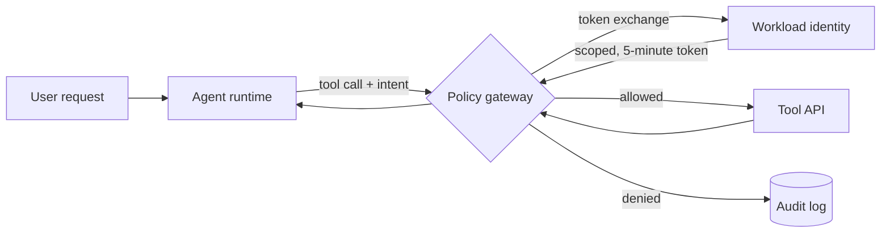

Most agent incidents I have reviewed this year started the same way: a capable model, a helpful tool, and a credential that could do far more than the task in front of it. The model did not need to be malicious. It only needed to be wrong once, or to read one poisoned document, while holding a token that opened every door in the subscription.

This post is the practical half of the series. The first part argued that an agent is a workload and should be treated like one. Here I walk through the pattern I now use by default: a policy gateway between the agent and its tools, workload identity instead of stored secrets, and tokens that live for minutes and carry one narrow scope.

## The problem with "the agent's credentials"

When a team says an agent "has access" to something, they usually mean one of three things. The agent runs with a developer's delegated token, it reads a long-lived client secret from configuration, or it borrows the managed identity of the host it runs on. All three share a flaw: the credential is sized for the *agent*, not for the *call*.

That mismatch matters because the model decides which tool to call and with which arguments. Prompt injection is still the top risk on the OWASP list for LLM applications,[^owasp-llm-top-10] and the reason is structural. Any text the model reads can steer its next action, so every tool the agent can reach is reachable by whoever controls that text.

> If the blast radius of a single wrong tool call is your whole tenant, the model's accuracy is now a security control. It was never designed to be one.

The NIST AI Risk Management Framework describes this as a governance problem as much as a technical one: you need to know which actions a system can take and who is accountable for each.[^nist-ai-rmf] The technical answer is old and boring, which is good news. Apply least privilege at the level of the individual call.

## The pattern in one diagram



The agent never holds a credential for the tool. It sends the gateway a tool call plus a short statement of intent. The gateway evaluates policy, exchanges its own workload identity for a token scoped to that one operation, makes the call, and returns the result. Every decision lands in the audit log, including denials.

### Why a gateway and not a better prompt

You can ask the model to be careful, and you should. But instructions are inputs, and inputs can be overridden. A gateway is code that runs outside the model's context, so injected text cannot argue with it. MITRE ATLAS catalogues enough real attack techniques against ML systems to make this distinction concrete.[^mitre-atlas]

:::note
The gateway does not need to be a separate product. In my last two deployments it was a few hundred lines of code in the same container as the agent runtime, running under a different identity and listening only on a local socket.
:::

## Threat model

I start every design review with a small table. It keeps the conversation on actions and consequences rather than on model behaviour, which nobody in the room can fully predict.

| Threat | Example | Control | Residual risk |
| --- | --- | --- | --- |
| Prompt injection | A retrieved web page tells the agent to export a mailbox | Gateway policy denies `mail.export` for this agent | Low |
| Over-broad token | Agent token can write to every storage account | Per-call token scoped to one container | Low |
| Credential theft | Client secret leaked from configuration | Workload identity federation, no stored secret | Low |
| Confused deputy | Tool acts with the agent's rights on a user's behalf | Pass the user's identity; check both | Medium |
| Silent failure | Denials are not visible to operators | Denials alerted and reviewed weekly | Medium |

The two "medium" rows are honest. Delegation is hard, and alert fatigue is real. A threat model that shows only green is usually one nobody has tested.

## Implementation walkthrough

The steps below use Microsoft Entra workload identity federation because that is where most of my clients run, but the shape is the same on any platform with token exchange.[^entra-workload-id]

1. Give the gateway its own identity. Never reuse the agent's.
2. Federate that identity with the platform that runs the gateway, so no secret exists anywhere.
3. Define one app role per tool operation, not per tool.
4. Make the gateway request a token for exactly the role the call needs.
5. Log the decision, the role, and a hash of the arguments before making the call.

Here is the federation step with the Azure CLI. It trusts tokens issued to one workload, in one namespace, for one service account:

```bash
az identity federated-credential create \
  --name agent-gateway-prod \
  --identity-name id-agent-gateway \
  --resource-group rg-agents-prod \
  --issuer "https://oidc.example-cluster.internal" \
  --subject "system:serviceaccount:agents:gateway" \
  --audiences "api://AzureADTokenExchange"
```

The policy itself can start as data. I keep it in the repository, reviewed like code:

```yaml
agent: research-assistant
allow:
  - tool: search.query
    max_calls_per_minute: 30
  - tool: storage.read
    scope: container:briefs
deny:
  - tool: mail.*
  - tool: storage.write
default: deny
```

And the gateway's decision record is small enough to keep forever:

```json
{
  "agent": "research-assistant",
  "tool": "storage.read",
  "decision": "allow",
  "scope": "container:briefs",
  "args_sha256": "9f2c4e0d1b7a",
  "token_ttl_seconds": 300
}
```

:::tip
Hash the arguments instead of logging them. You still get correlation across retries and replays, and you do not turn your audit log into a second copy of every document the agent touched.
:::

### Token lifetime

Five minutes is my default, and I shorten it for write operations. The common objection is latency: a token exchange per call adds a round trip. In practice the gateway caches a token per role for most of its lifetime, and the cost is a few milliseconds per call against model latency measured in seconds.

### Delegated calls

Some tools must act as the user, not as the agent. Here the gateway needs both identities: the user's, to decide what the user may do, and its own, to prove the request came through policy. Check both. If you only check the user, any agent that can obtain a user token becomes a skeleton key.

:::warning
Do not let the agent request user tokens directly. If the model can trigger an interactive consent prompt, an injected instruction can phish your own users through your own app.
:::

## Pitfalls I keep seeing

- **Scopes that mirror the API, not the task.** `Files.ReadWrite.All` is convenient and always too much. Model the operation the agent performs.
- **Gateways that fail open.** If policy cannot be evaluated, the answer is deny. Make that a test, not a comment.
- **One identity for many agents.** You lose the ability to revoke one agent without breaking the others, and your audit log stops answering "which agent did this?"
- **Denials nobody reads.** A denied call is the most useful signal you have that an injection attempt happened. Alert on spikes.
- **Policies written once.** Tools change. Review the allow list whenever a tool's API changes, the same way you would review a firewall rule.

The CISA guidance on secure AI system development makes the same point in more formal language: secure design, secure deployment, and secure operation are separate phases with separate owners.[^cisa-secure-ai] The gateway is where those phases meet.

## A checklist for your next design review

- [x] The agent has no stored credentials for any tool
- [x] Every tool call passes through a gateway that runs outside the model's context
- [ ] Each tool operation maps to one narrowly scoped role
- [ ] Tokens live for five minutes or less, shorter for writes
- [ ] Denials are logged, alerted and reviewed
- [ ] Delegated calls check both the user and the gateway identity

## What I would change next time

I would introduce the gateway earlier. On both projects it arrived after a prototype had already shipped with a broad token, and unwinding that took longer than building the gateway did. Starting with deny-by-default felt slower for about a week and then stopped feeling like anything at all.

I would also make the decision log visible to the product team, not just to security. When people can see which calls the agent attempts and which ones policy blocks, conversations about new tools become concrete very quickly.

The Model Context Protocol makes tools easier to plug in, which is exactly why this matters now.[^mcp-spec] Easier integration means more tools per agent. Least privilege per call is how you keep that from meaning more risk per agent.

[^owasp-llm-top-10]: OWASP. *Top 10 for LLM Applications 2025*. [genai.owasp.org](https://genai.owasp.org/llm-top-10/)
[^nist-ai-rmf]: NIST. *Artificial Intelligence Risk Management Framework (AI RMF 1.0)*, January 2023. [nist.gov](https://www.nist.gov/itl/ai-risk-management-framework)
[^mitre-atlas]: MITRE. *ATLAS: Adversarial Threat Landscape for Artificial-Intelligence Systems*. [atlas.mitre.org](https://atlas.mitre.org/)
[^entra-workload-id]: Microsoft. *Workload identity federation*. [learn.microsoft.com](https://learn.microsoft.com/en-us/entra/workload-id/workload-identity-federation)
[^cisa-secure-ai]: CISA and NCSC. *Guidelines for secure AI system development*. [cisa.gov](https://www.cisa.gov/resources-tools/resources/guidelines-secure-ai-system-development)
[^mcp-spec]: Model Context Protocol. *Specification*. [modelcontextprotocol.io](https://modelcontextprotocol.io/specification)
