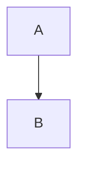

## Setext Heading Level 2

# Setext Heading Level 1 Is Still Parsed

Alternate *emphasis* with underscores and **strong underscores**.

- star bullet
- another star

Paragraph between two lists.

- plus bullet
- another plus

Soft-wrapped paragraph that continues on the next line and on a third, indented line.

Two-space hard break\
works too.

```python
print("tilde fence")
```

```
indented code block
second line
```

Autolinks: [https://example.com/auto](https://example.com/auto) and [hello@example.com](mailto:hello@example.com).

Reference link: [the spec](https://spec.commonmark.org/0.31.2/ "CommonMark spec") and a collapsed one: [spec](https://spec.commonmark.org/0.31.2/ "CommonMark spec").

Entities: © — — — &  end.

Unnecessary escapes: . ! ( ) : @ - # > in the middle.

### Closed ATX heading

# Heading with extra spaces

| a | b |
| --- | ---: |
| 1 | 2 |

- [x] uppercase X task
- [ ] lowercase task

1. ordered
2. all ones
3. numbering

Trailing spaces at the end of a paragraph

---

---



```TypeScript title="example.ts"
const answer = 42
```

Final paragraph with `code` inside.

Extra blank lines above are collapsed.
